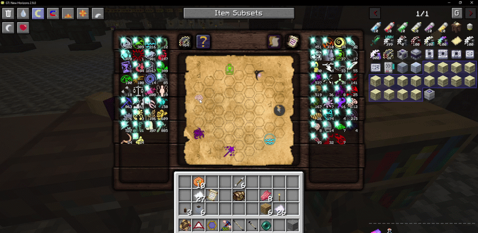

# Thaumcraft 4 Research Solver & Clicker

Deterministic, coordinate-based research board solver and drag-and-drop clicker for Thaumcraft 4 / GTNH—zero OCR or computer vision required.



---

## How It Works (3 Steps)

1. **Calibrate once:** Record your screen positions for the hex grid and aspects (using column sweeps and quick section/item skips).
2. **Draw the board in the GUI:** Set the board size (`S`, `M`, or `L`), paint starting aspects, mark blocked/dead hexes, and set your available aspect counts.
3. **Solve & Run:** Hit **Solve** to compute a valid aspect chain and preview it on the canvas, then hit **Run Clicker** to drag-and-drop aspects onto the board in-game.

---

## Setup

* **Python:** `3.10+`
* **Dependencies:** `Pillow` (for loading aspect PNG icons)

```bash
git clone <your-repo-url>
# or download and extract the ZIP archive from GitHub
cd ThaumcraftResearcher
pip install pillow
python .\src\recorder.py
python run_gui.py
```
---

## How to Use

### 1. Calibrate Screen Coordinates

Run the recorder module and follow the prompts in your terminal:

```bash
python -m src.recorder

```

* Use the on-screen hotkeys in the terminal to record (`F1`), skip an item (`F2`), skip an entire section (`F3`), step back (`F4`), or save and exit (`Esc`).
* **Skipping & aspect order:** You can skip sections or individual aspects you haven't unlocked yet. Keep in mind that **unlocking a new aspect later can shift positions** in your research panel—if that happens, re-record affected aspects so your coordinates stay aligned.

### 2. Launch the GUI & Set Up the Puzzle

Start the interface from the project root:

```bash
python run_gui.py

```

* **Board size:** Pick Small (`19`), Medium (`37`), or Large (`61`) to match the research note in-game.
* **Select & search aspects:** Filter aspects using the search bar, click an aspect card to select it, and left-click (or drag) on hexes to place starting aspects.
* **Dead / blocked hexes:** **Right-click** any hex to toggle it as dead (`X`) so the solver routes around it.
* **Inventory counts:** Adjust per-aspect counts (or bulk-set values) and save your inventory so the solver respects what you actually have.

### 3. Solve & Run the Clicker

1. Click **Solve** (or **Solve & Save Plan**) to compute the placement plan and inspect the resulting connections and placed aspects on the board.
2. Adjust the **delay** (countdown before execution starts so you have time to focus Minecraft) and **click/drag speed** controls.
3. Click **Run Clicker**, switch to or let Minecraft be focused before the timer finishes, and watch it drag each aspect from its recorded position onto its target hex. *(Press `Esc` or move the cursor to the top-left corner to abort early.)*

---

## Under the Hood: The Solver

* **State-space shortest path:** Searches over `(hex, aspect)` states using Dijkstra's algorithm, linking adjacent active hexes only where a valid direct recipe relationship exists.
* **Stock & cost aware:** Tracks your remaining aspect counts during search and factors in aspect costs so it doesn't spend aspects you don't have.
* **Multi-start network linking:** Connects starting aspects on the board into a single linked network across valid paths.

---

## Limitations

* **Windows only:** Uses `ctypes.windll` (`user32`) for cursor positioning, mouse events, and key-state polling.
* **Resolution & UI scale sensitive:** Recorded coordinates in `data/coords.json` assume the same monitor resolution, display scaling, and Minecraft GUI scale/window layout used during calibration. Changing window size or GUI scale will misalign clicks.

---

## Disclaimer

This project is an unofficial community utility and is **not affiliated with or endorsed by Thaumcraft or GTNewHorizons (GTNH)**. Use automation/auto-clickers responsibly and only where permitted—never use macros or automated input tools on multiplayer servers that prohibit them.

